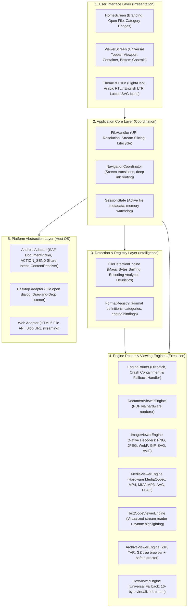
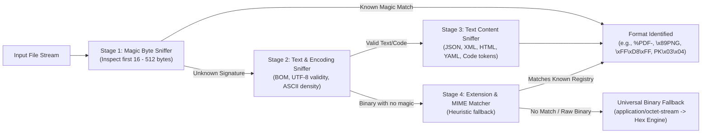
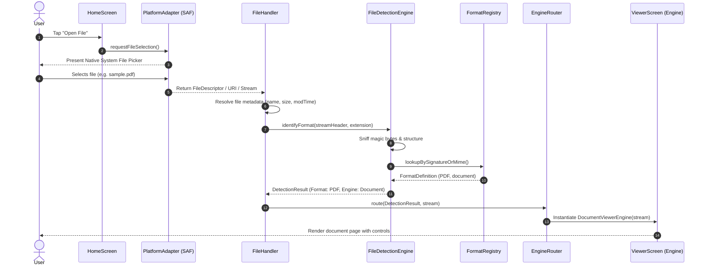
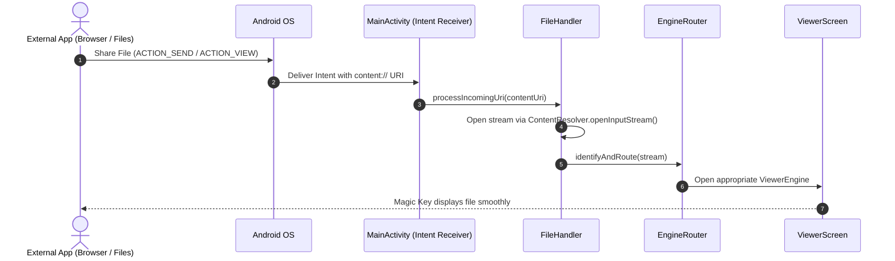
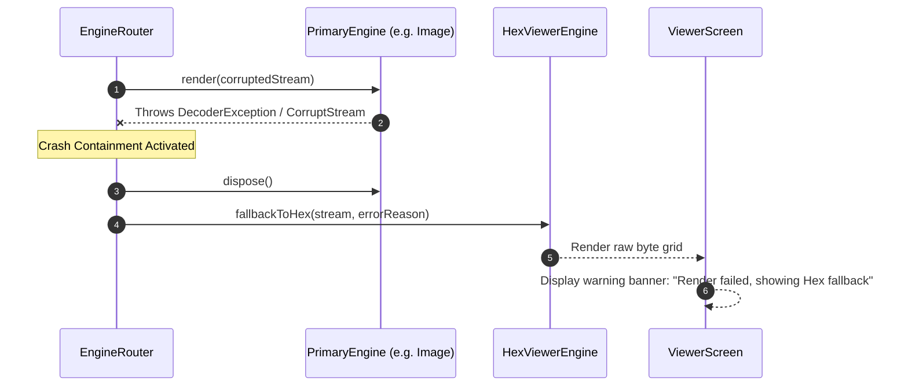

# Magic Key — System Architecture Specification

> **Technical Architecture, Data Flow, Engine Routing, and Safety Containment**  
> **Target Release:** v0.1.0  
> **Document Status:** Active Specification  
> **Workspace Path:** `/storage/emulated/0/ANTYEE/MagicKey/ARCHITECTURE.md`  

---

## 1. Architectural Overview & System Layers

Magic Key utilizes a **strictly layered, decoupled modular architecture**. Each layer has distinct responsibilities and does not leak implementation details to adjacent layers.



---

## 2. Component Specifications

### 2.1 File Detection Engine (`file_detection/`)
The Detection Engine operates as a high-speed multi-stage pipeline. It never trusts filename extensions blindly.



#### Magic Byte Sniffing Rules
1. **Header Inspection:** Reads up to 512 bytes from offset 0.
2. **Compound Signatures:** Certain formats (like ZIP-based formats such as DOCX, APK, JAR, EPUB) share identical initial magic bytes (`50 4B 03 04`). In such cases, the sniffer inspects internal directory markers or secondary offsets without decompressing the payload.
3. **Encoding Validation:** If magic bytes do not yield an exact binary match, the buffer is analyzed for valid UTF-8 sequences, UTF-16 BOMs (`FE FF` or `FF FE`), or high ASCII density. If text is confirmed, syntax tokens (`<!DOCTYPE html`, `<?xml`, `{`, `[`) determine specific text formats.

---

### 2.2 Format Registry (`format_registry/`)
The Format Registry maintains the immutable database of supported formats, categories, and viewing capabilities.

```dart
// Format Definition Model
class FormatDefinition {
  final String id;                  // e.g., 'pdf', 'png', 'zip', 'rust'
  final String displayName;         // e.g., 'Portable Document Format'
  final FileCategory category;      // document, image, media, text_code, archive, binary
  final List<String> extensions;    // e.g., ['pdf']
  final List<String> mimeTypes;     // e.g., ['application/pdf']
  final List<MagicSignature> magic; // Byte patterns & offset masks
  final EngineType primaryEngine;   // EngineType.document
  final EngineType fallbackEngine;  // EngineType.hex
  final Set<FormatCapability> caps; // zoom, search, extract, play, wrap
}
```

#### File Categories:
1. **Document:** PDF, EPUB, TXT, RTF.
2. **Image:** JPEG, PNG, WebP, GIF, BMP, SVG, ICO, AVIF.
3. **Media (Audio/Video):** MP4, MKV, WebM, MP3, AAC, WAV, FLAC, OGG, M4A.
4. **Text & Source Code:** Markdown, JSON, YAML, XML, HTML, CSS, JavaScript, TypeScript, Python, Rust, Dart, C, C++, Java, Go, Shell, SQL.
5. **Archive:** ZIP, TAR, GZ, TGZ, BZ2.
6. **Binary / Unknown:** Executable files, firmware blobs, unknown binary streams (routed directly to Hex Viewer).

---

### 2.3 Engine Router & Crash Isolation (`engines/`)
The Engine Router maps identified format IDs to viewer instances. It acts as a safety firewall:

1. **Lazy Loading:** Viewing engines are never loaded into RAM during application launch. An engine instance is spun up only when the user requests viewing.
2. **Crash Containment:**
   * Every engine execution is wrapped inside a defensive error-handling boundary.
   * If an engine throws an unhandled decoder exception, out-of-spec format error, or codec initialization failure, the Router catches the error, logs a clean diagnostic message, and **immediately switches the active viewer to the Universal Hex Viewer**.
   * An unobtrusive notification banner explains: *"Rendering engine encountered a format error. Displaying raw data via Hex Viewer."*
3. **Resource Teardown:** When navigating back to the Home Screen or opening a new file, the previous engine's `dispose()` method is guaranteed to execute, closing open file descriptors, freeing native textures, and zeroing cached buffers.

---

### 2.4 Viewer Engine Specifications

#### A. Document Viewer Engine (`engines/document/`)
* **Android Target:** Uses the platform's built-in `android.graphics.pdf.PdfRenderer`.
* **Zero APK Bloat:** Relies on system-provided hardware acceleration.
* **Capabilities:** Multi-page vertical scrolling, pinch-to-zoom, page counter jump, fit-to-width.

#### B. Image Viewer Engine (`engines/image/`)
* **Decoders:** Hardware-accelerated native image decoders (Skia/Impeller) for raster images; pure vector parser for SVG.
* **Capabilities:** Smooth 2D pan and zoom gestures (up to 10x), aspect ratio preservation, image dimensions & color depth metadata badge.

#### C. Media Viewer Engine (`engines/media/`)
* **Decoders:** Platform MediaCodec (Android Media3 / ExoPlayer; iOS AVPlayer).
* **Capabilities:** Audio waveform / cover display for audio tracks; hardware video surface for video. Play, pause, seek bar, time elapsed/remaining, volume toggle.

#### D. Text & Code Viewer Engine (`engines/text_code/`)
* **Virtualization:** Uses a virtualized list view to avoid loading the entire text document into memory at once.
* **Syntax Highlighting:** Fast tokenization supporting 180+ languages.
* **Capabilities:** Line numbering, word-wrap toggle, monospaced font rendering, character encoding detection badge.

#### E. Archive Viewer Engine (`engines/archive/`)
* **Security Constraints:** Read-only hierarchical directory tree browser.
* **Zip-Bomb Protection:** Never decompress entire archives into RAM or storage. Only directory headers are parsed into a tree model.
* **Path Traversal Guard:** Any entry path containing `..` or absolute prefixes (`/`, `\`, `C:`) is stripped and normalized to a flat relative namespace.
* **Entry Inspection:** Clicking a supported entry inside the archive decompresses that single item into a memory stream and routes it to the matching Viewer Engine.

#### F. Universal Hex Viewer Engine (`engines/hex/`)
* **Architecture:** Virtualized 16-byte grid with page-based chunked streaming (reads 4KB to 64KB pages on demand).
* **Column Layout:**
  `[ Offset (8 hex digits) ]  [ 16 Hex Bytes (2 groups of 8) ]  [ ASCII Representation (16 chars) ]`
* **Performance:** Fixed memory footprint (~5 MB) whether opening a 10 KB file or a 10 GB file. Instantaneous load time (<100ms).
* **Navigation:** Fast scroll bar, jump to offset address, byte inspection inspector.

---

## 3. End-to-End Data Flow & Sequence Diagrams

### 3.1 User File Opening & Detection Sequence



### 3.2 Android Share Intent Flow



### 3.3 Engine Error Recovery & Fallback Flow



---

## 4. Platform Abstraction Layer (PAL)

To guarantee portability across Android, iOS, Windows, macOS, Linux, and Web, the core relies on abstract interfaces:

```dart
abstract class PlatformFileSource {
  String get name;
  int get size;
  Stream<List<int>> openRead([int? start, int? end]);
  Future<List<int>> readHeader(int maxBytes);
  void close();
}

abstract class PlatformInteractionBridge {
  Future<PlatformFileSource?> pickSingleFile();
  Stream<PlatformFileSource> get incomingSharedFiles;
  void shareActiveFile(PlatformFileSource file);
}
```

* **Android Implementation:** Interfaces with `android.net.Uri`, `ContentResolver`, and Android SAF without requiring raw file path access (fully compliant with Scoped Storage).
* **Desktop Implementation:** Interfaces with native file system paths, standard I/O streaming, and drag-and-drop event targets.
* **Web Implementation:** Interfaces with `dart:html` / `package:web` File and FileReader APIs using Blob slicing.
