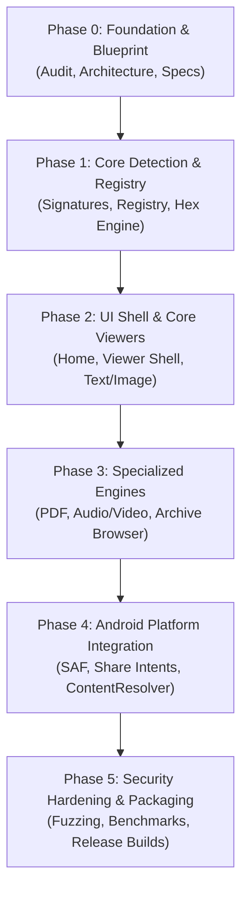

# Magic Key — Implementation Roadmap

> **Development Phases, Milestones, Acceptance Criteria, and Dependency Graph**  
> **Target Release:** v0.1.0 (MVP) through v1.0.0  
> **Current Phase:** Phase 0 (Foundation Completed)  
> **Workspace Path:** `/storage/emulated/0/ANTYEE/MagicKey/ROADMAP.md`  

---

## 1. Overview & Phased Strategy

The implementation of Magic Key follows a strict dependency hierarchy: **Foundation -> Detection & Core -> UI Shell -> Specialized Engines -> Platform Integration -> Hardening**.

---

## 2. Detailed Phase Specifications

### Phase 0: Inception, Environment Inspection & Foundation
**Status:** `COMPLETED`  
**Deliverables:**
- [x] Host environment hardware and storage inspection (Termux & Ubuntu PRoot).
- [x] Storage permissions verified on `/storage/emulated/0/ANTYEE/MagicKey/`.
- [x] FUSE filesystem constraints documented (no-symlinks, masked execute bit).
- [x] Toolchain availability audit (Rust 1.99.1, Clang 21.1.8, OpenJDK 21, Python 3.14).
- [x] Technical architecture specification (`ARCHITECTURE.md`).
- [x] Master project blueprint (`PROJECT_BLUEPRINT.md`).
- [x] License audit and attribution policy (`LICENSES.md`).
- [x] Initial directory layout created.

---

### Phase 1: Core Format Detection & Registry Engine
**Status:** `COMPLETED`  
**Milestone:** `v0.1.0-alpha.1`  
**Focus:** Pure, standalone intelligence layer for format identification and raw byte inspection.

#### Completed Deliverables:
- [x] **Magic Byte Signature Database (`file_detection/signatures.json`):** Expanded database covering PDF, PNG, JPEG, GIF, WebP, BMP, AVIF, ZIP, GZIP, TAR, 7z, BZ2, MP4, MKV/WebM, MP3, WAV, FLAC, OGG, SQLite, ELF, DEX, Java Class, and PE executables.
- [x] **Multi-Stage Detection Engine (`core/src/file_detection/`):**
  - BOM detection (UTF-8, UTF-16LE/BE, UTF-32LE/BE).
  - Bounded content inspection distinguishing text from binary.
  - Text subtype tokenization (JSON, XML, HTML, SVG, Markdown, Shell).
  - Secondary extension hint validation (never trusted when magic is absent).
- [x] **Centralized Format Registry (`core/src/format_registry/`):** Model, case-insensitive index, 39 standard format definitions, and engine routing.
- [x] **Universal Hex Viewer Engine Core (`core/src/engines/hex/`):** Canonical 16-byte aligned row formatter, incremental stream reader, seeking, and bounded chunking.
- [x] **C-ABI Foreign Function Interface (`core/src/ffi.rs`):** Exported dynamic symbols (`libmagickey_core.so`) for seamless Flutter `dart:ffi` integration.
- [x] **CLI Tool (`magickey_cli`):** Standalone binary for command-line file identification and hex dumping.
- [x] **Automated Test Suite & Verification Harness (`scripts/run_phase1_tests.py`):** 15 Cargo unit/integration tests + 22 end-to-end FFI fixture tests (100% pass rate).

#### Acceptance Criteria Fulfilled:
- [x] Magic byte detector identifies target formats with 100% accuracy within the first 512 bytes.
- [x] Corrupted or truncated files do not panic; fallback safely to `unknown_binary` and Hex Viewer.
- [x] All detection and hex code passes automated unit and FFI tests in the CLI environment.

---

### Phase 2: Application UI Shell & Core Viewers
**Target Milestone:** `v0.1.0-alpha.2`  
**Focus:** Clean, modern, responsive UI shell supporting English (LTR) and Arabic (RTL).

#### Tasks:
1. **Application Shell (`app/`):**
   * Setup Flutter application structure (`main.dart`, `app.dart`).
   * Theme configuration: Strict Material 3, Dark and Light mode color palettes.
   * Directionality and Localization: Full Arabic (RTL) and English (LTR) strings.
2. **Main Screen (`app/screens/home_screen.dart`):**
   * Minimal branding: Magic Key logo & title.
   * Prominent "Open File" primary action button.
   * Category preview grid with Lucide SVG icons.
   * File drag-and-drop listener target (for desktop/web).
3. **Viewer Shell (`app/screens/viewer_screen.dart`):**
   * Top navigation bar: Back button, file title, detected format badge, file size indicator.
   * Central responsive viewport area with lazy-loaded engine mounting.
   * Bottom contextual actions bar (zoom controls, search, format info modal).
4. **Text & Source Code Viewer Engine (`engines/text_code/`):**
   * Virtualized scrolling list for text files.
   * Syntax highlighting for 50+ key programming languages.
   * Monospaced line numbers and word-wrap toggle.
5. **Image Viewer Engine (`engines/image/`):**
   * High-performance 2D pan, pinch-to-zoom, and double-tap zoom gestures.
   * Raster format support (PNG, JPEG, WebP, GIF, BMP, AVIF) and vector (SVG).

#### Acceptance Criteria:
* Zero frame drops during viewport transitions.
* Arabic typography and layout render correctly right-to-left without clipped text.
* Large text files (>10 MB) scroll smoothly without lagging or UI freezing.

---

### Phase 3: Specialized Viewing Engines
**Target Milestone:** `v0.1.0-beta.1`  
**Focus:** Documents, audio/video playback, and safe archive browsing.

#### Tasks:
1. **Document Viewer Engine (`engines/document/`):**
   * Android native `PdfRenderer` integration via Platform View or Texture surface.
   * Page thumbnail strip, vertical smooth paging, and fit-to-width/height.
2. **Media Viewer Engine (`engines/media/`):**
   * Audio/Video player using platform hardware decoders (`Media3` / `ExoPlayer`).
   * Minimal controls overlay: Play/Pause, seek timeline, elapsed/total time, mute/unmute.
   * Waveform or metadata art display for pure audio files.
3. **Archive Viewer Engine (`engines/archive/`):**
   * Safe tree-based directory explorer for ZIP, TAR, GZ archives.
   * File metadata table (compressed size, uncompressed size, modification date).
   * In-place entry preview (clicking an image or text file inside the zip opens it seamlessly in Magic Key).

#### Acceptance Criteria:
* Multi-page PDFs render with hardware acceleration and clear vector text.
* Media files play immediately with hardware acceleration without requiring external players.
* Archive browsing is read-only, handles nested folders cleanly, and blocks malicious path extraction.

---

### Phase 4: Android Platform Integration
**Target Milestone:** `v0.1.0-rc.1`  
**Focus:** Deep Android OS integration with Scoped Storage and Share Intents.

#### Tasks:
1. **Storage Access Framework (SAF) Bridge:**
   * Open document picker with `Intent.ACTION_OPEN_DOCUMENT` and wildcard MIME types (`*/*`).
   * Persistent URI permission retention where required.
2. **Share Intent Receiver:**
   * `AndroidManifest.xml` intent filters for `android.intent.action.VIEW` and `android.intent.action.SEND`.
   * Resolve incoming `content://` streams directly via Android `ContentResolver`.
3. **Crash Containment & Error Handling:**
   * Defensive boundaries surrounding all engine entry points.
   * Automatic redirection to Hex Viewer on engine decoder failures.

#### Acceptance Criteria:
* Opening a file from Google Files, WhatsApp, or Chrome "Open with Magic Key" launches the viewer instantly.
* Magic Key handles Scoped Storage `content://` URIs without requesting legacy broad storage permissions.

---

### Phase 5: Security Hardening, Verification & Packaging
**Target Milestone:** `v0.1.0` (Production Release)  
**Focus:** Threat validation, performance benchmarking, and multiplatform distribution.

#### Tasks:
1. **Security & Fuzz Testing (`tests/security/`):**
   * Zip-bomb test cases: verify extraction aborts when expansion ratio exceeds 100:1.
   * Path traversal test cases: verify paths with `../../` are neutralized.
   * Corrupted file test cases: verify corrupted JPEGs, PDFs, and MP4s trigger Hex fallback gracefully.
2. **Performance Benchmarking:**
   * Cold startup time < 500ms on mid-range Android devices.
   * Memory ceiling < 45 MB baseline, < 85 MB during active media playback.
3. **Release Packaging & CI/CD Scripts:**
   * Automated build scripts (`scripts/package_release.sh`).
   * APK alignment and v2/v3 signing.
   * GitHub Actions workflow definition for cross-platform binaries (Android, Windows, Linux, macOS).

#### Acceptance Criteria:
* Zero unhandled crashes across all security test vectors.
* Final release APK size < 20 MB.
* 100% offline functionality verified.

---

## 3. Dependency & Risk Management

| Risk | Impact | Mitigation Strategy |
|---|---|---|
| **Storage exhaustion on dev device (3.8GB free)** | High | Run lightweight tests locally; defer monolithic SDK installations; use GitHub Actions CI for heavy cross-platform compilation. |
| **Unsupported codec in native player** | Medium | Engine Router catches playback error and presents Hex fallback with media metadata summary. |
| **Rogue large archive (Zip Bomb)** | High | Hard limits on decompression ratio (100:1) and preview file size (50 MB max). |
| **FUSE permission quirks on Android shared storage** | Low | Run scripts explicitly through interpreters (`python3`, `bash`); build native artifacts in internal app storage when compiling locally. |
